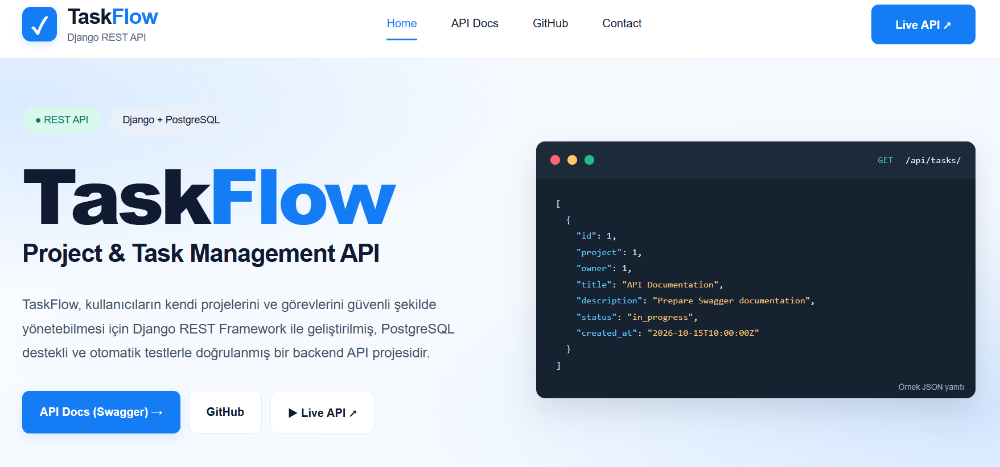
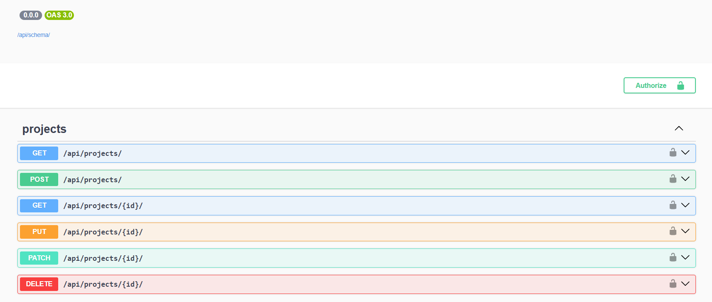
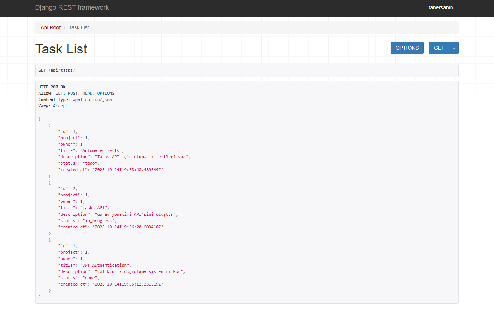
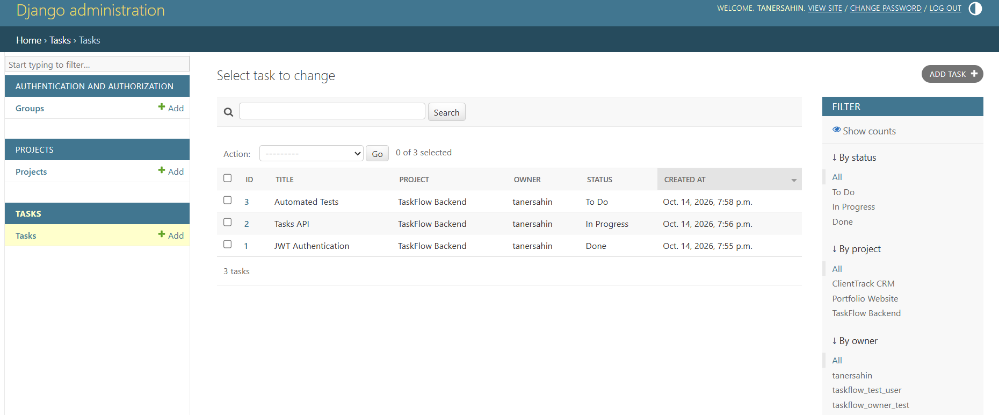

# TaskFlow — Project & Task Management REST API

**A backend-focused project and task management REST API built with Django REST Framework and PostgreSQL.**

TaskFlow demonstrates secure API development with relational database models, CRUD operations, JWT authentication, user-specific permissions, ownership protection, automated testing, and interactive API documentation.

> **Project Status:** Backend development and local testing completed. The project is available on GitHub. Production deployment using Ubuntu VPS, Gunicorn, Nginx, and HTTPS is planned as a possible future improvement. No public live API is currently available.

**Repository:** https://github.com/taner-sahin/TaskFlow  
**Developer Portfolio:** https://tanersahindev.com/

---

## Project Preview



TaskFlow includes a responsive landing page introducing the API, its technologies, and its main capabilities.

## Key Features

- Django REST Framework backend architecture
- PostgreSQL relational database
- Custom Django user model
- User registration
- JWT access and refresh token authentication
- Projects CRUD API
- Tasks CRUD API
- Project and task relationships
- Authentication and authorization
- User-specific data isolation
- Ownership-based access protection
- Interactive Swagger/OpenAPI documentation
- Customized Django Admin interface
- Automated API and security testing
- **25 automated tests passing in the latest verified local run**

## API Architecture

TaskFlow separates database models, serializers, API views, URL routing, authentication, and permissions.

```text
API Client / Swagger / Postman
             |
             v
       REST Endpoint
             |
             v
  Authentication & Permissions
             |
             v
          ViewSet
             |
             v
         Serializer
             |
             v
         Django ORM
             |
             v
         PostgreSQL
             |
             v
        JSON Response
```

### Main Components

**Models** define users, projects, tasks, and database relationships.

**Serializers** convert model instances into API representations and validate incoming data.

**ViewSets** implement CRUD operations and manage API requests.

**Routers** generate REST endpoint URLs.

**Authentication** identifies users through JWT tokens or supported authenticated sessions.

**Permissions** restrict access to protected API operations.

**Ownership** ensures users can access only the projects and tasks they are authorized to manage.

**Django ORM** handles database operations using Python instead of requiring handwritten SQL for ordinary application queries.

---

## Projects API

The Projects API allows authenticated users to create, retrieve, update, and delete their own projects.

### Endpoints

```http
GET    /api/projects/
POST   /api/projects/
GET    /api/projects/{id}/
PUT    /api/projects/{id}/
PATCH  /api/projects/{id}/
DELETE /api/projects/{id}/
```

Project records include:

- Name
- Description
- Owner
- Creation timestamp

Project querysets are restricted to the authenticated user.

## Tasks API

The Tasks API manages tasks associated with projects.

### Endpoints

```http
GET    /api/tasks/
POST   /api/tasks/
GET    /api/tasks/{id}/
PUT    /api/tasks/{id}/
PATCH  /api/tasks/{id}/
DELETE /api/tasks/{id}/
```

Task records include:

- Title
- Description
- Related project
- Owner
- Status
- Creation timestamp

Supported task statuses include:

- `todo`
- `in_progress`
- `done`

Tasks are protected through authentication and ownership rules. Users cannot access or modify another user's tasks through the API.

### Relational Data Model

```text
User
 |
 +---- owns ----> Project
 |                  |
 |                  +---- contains ----> Task
 |
 +---- owns --------------------------> Task
```

TaskFlow focuses on individual user ownership. Team membership and task assignment to other users are not implemented.

---

## JWT Authentication

TaskFlow uses **SimpleJWT** for token-based authentication.

### Authentication Endpoints

```http
POST /api/users/register/
POST /api/token/
POST /api/token/refresh/
```

### Authentication Flow

```text
User Registration / Login
          |
          v
   Receive JWT Tokens
          |
          v
      Access Token
          |
          v
 Authorization Header
          |
          v
   Protected API Request
```

### Example Login Request

```http
POST /api/token/
Content-Type: application/json
```

```json
{
  "username": "your_username",
  "password": "your_password"
}
```

The login endpoint returns access and refresh tokens when valid credentials are provided.

Authenticated requests use the access token:

```http
Authorization: Bearer <access_token>
```

The refresh token can be used to obtain a new access token.

---

## Authentication, Permissions & Security

TaskFlow implements backend-enforced security rules.

### Authentication

Protected API endpoints require an authenticated user.

The default permission class uses `IsAuthenticated`, while user registration is explicitly available without authentication.

### Authorization

Authenticated users can perform operations only when the application's permission rules allow them.

### Ownership Protection

Projects and tasks are filtered according to the authenticated user.

Security checks include:

- Preventing access to another user's projects
- Preventing access to another user's tasks
- Preventing unauthorized task deletion
- Preventing task ownership reassignment through submitted request data
- Validating project ownership when working with related tasks

An unauthorized request for another user's task can return `404 Not Found` because the task is excluded from the requesting user's queryset.

These protections are enforced by the backend, independently of the landing page.

---

## Swagger & OpenAPI Documentation

TaskFlow uses **drf-spectacular** to generate interactive API documentation.

### Local Documentation URLs

| Resource | URL |
|---|---|
| Swagger UI | `http://127.0.0.1:8000/api/docs/` |
| OpenAPI Schema | `http://127.0.0.1:8000/api/schema/` |

Swagger provides endpoint documentation, request and response schemas, and interactive API testing.

JWT authorization has also been verified locally with protected API requests.

### Swagger Screenshot



The screenshot demonstrates the documented Projects API endpoints and available HTTP methods.

---

## API Response Example

TaskFlow returns JSON responses through Django REST Framework.

### Tasks API — HTTP 200 OK



The screenshot shows a successful authenticated request to:

```http
GET /api/tasks/
```

The response contains task records retrieved from PostgreSQL.

Each task includes its project relationship, owner, title, description, status, and creation timestamp.

---

## Automated Testing

TaskFlow includes automated tests covering API functionality, authentication, permissions, and ownership protection.

**Latest verified local result: 25 automated tests passing.**

Test coverage includes:

- Project API operations
- User registration and authentication
- Task API operations
- User-specific data access
- Ownership protection
- Security-related permission scenarios

### Run Tests

```powershell
python manage.py test
```

Automated testing helps verify existing behavior and detect regressions when the application changes.

---

## Django Admin

TaskFlow includes customized Django Admin interfaces for Projects and Tasks.

Admin improvements include:

- Customized list displays
- Search functionality
- Filtering by relevant fields
- Related project and owner information
- Ordering
- Read-only creation timestamps
- Query optimization using related-object loading where configured

### Django Admin Screenshot



The Tasks administration screen displays task IDs, titles, related projects, owners, statuses, and creation timestamps.

It also provides search and filtering tools for managing records.

Admin access requires an authorized Django staff or superuser account.

---

## Technology Stack

| Category | Technology |
|---|---|
| Programming Language | Python 3.12 |
| Backend Framework | Django 5.2 |
| REST API | Django REST Framework |
| Database | PostgreSQL |
| Authentication | SimpleJWT |
| API Documentation | drf-spectacular |
| API Specification | OpenAPI 3 |
| Documentation Interface | Swagger UI |
| Testing | Django Test Framework / DRF Testing |
| Version Control | Git |
| Repository Hosting | GitHub |
| Development Environment | Windows PowerShell / Visual Studio Code |

Exact dependency versions are listed in `requirements.txt`.

---

## Project Structure

```text
TaskFlow/
|
|-- config/             # Django configuration
|-- core/               # Homepage and core functionality
|-- users/              # Custom user model and registration
|-- projects/           # Projects API
|-- tasks/              # Tasks API
|-- templates/          # HTML templates
|-- static/             # Static files and CSS
|-- media/              # Media directory
|-- screenshots/        # Project screenshots
|   |-- taskflow-home.png
|   |-- taskflow-swagger.png
|   |-- taskflow-tasks-api.png
|   `-- taskflow-admin.png
|
|-- manage.py
|-- requirements.txt
|-- .env.example
|-- .gitignore
`-- README.md
```

---

## Installation & Local Setup

The following steps describe a local development setup using Windows PowerShell.

### 1. Clone the Repository

```powershell
git clone https://github.com/taner-sahin/TaskFlow.git
cd TaskFlow
```

### 2. Create a Virtual Environment

```powershell
python -m venv venv
```

Activate it:

```powershell
.\venv\Scripts\Activate.ps1
```

### 3. Install Dependencies

```powershell
pip install -r requirements.txt
```

### 4. Configure Environment Variables

Create a `.env` file using `.env.example` as a reference.

Configure the environment variables required by `config/settings.py`, including the Django secret key and PostgreSQL connection settings.

**Never commit real credentials or secret keys.**

Ensure `.env` is excluded from version control through `.gitignore`.

### 5. Configure PostgreSQL

Install and start PostgreSQL.

Create a local database and database user with the permissions required by the Django application.

Ensure the database credentials match the values configured in `.env`.

For automated tests, the PostgreSQL role may require permission to create a temporary test database.

### 6. Apply Database Migrations

```powershell
python manage.py migrate
```

### 7. Run the Development Server

```powershell
python manage.py runserver
```

### 8. Open the Application

| Resource | Local URL |
|---|---|
| Homepage | `http://127.0.0.1:8000/` |
| Swagger Documentation | `http://127.0.0.1:8000/api/docs/` |
| Projects API | `http://127.0.0.1:8000/api/projects/` |
| Tasks API | `http://127.0.0.1:8000/api/tasks/` |
| Django Admin | `http://127.0.0.1:8000/admin/` |

Protected API endpoints require authentication.

### 9. Run Automated Tests

```powershell
python manage.py test
```

---

## Development Status

| Component | Status |
|---|---|
| Django project infrastructure | Completed |
| PostgreSQL integration | Completed locally |
| Custom user model | Completed |
| User registration | Completed |
| Projects API | Completed |
| Tasks API | Completed |
| JWT authentication | Completed |
| Authentication and permissions | Completed |
| Ownership protection | Completed |
| Swagger / OpenAPI documentation | Completed |
| Professional Django Admin | Completed |
| Automated tests | 25 passing in latest verified local run |
| README documentation | Completed |
| Project screenshots | Completed |
| GitHub repository | Available |
| Production deployment | Future improvement |

---

## Future Improvements

TaskFlow is currently maintained as a GitHub portfolio project.

Possible future improvements include:

- Ubuntu VPS deployment
- Gunicorn application server configuration
- Nginx reverse proxy configuration
- Production PostgreSQL configuration
- Domain and DNS configuration
- SSL/TLS certificates and HTTPS
- HTTP Strict Transport Security (HSTS)
- Additional automated testing
- CI/CD workflow
- Further API documentation improvements

These improvements are planned possibilities and are not presented as currently implemented features.

---

## What This Project Demonstrates

TaskFlow demonstrates practical backend development using Django REST Framework.

The project covers the complete local API development workflow:

**Database modeling → Serializers → ViewSets → Routers → Authentication → Permissions → Ownership → Testing → API Documentation**

It demonstrates the ability to build a relational API with user-specific data access, JWT authentication, automated testing, and organized Django applications.

The project is intended as a backend development portfolio example.

---

## Developer

**Python / Django Backend Developer**

**Portfolio:** https://tanersahindev.com/  
**GitHub:** https://github.com/taner-sahin

---

**TaskFlow — Django REST Framework & PostgreSQL Backend Portfolio Project**